# shiptrack-platform

The shared, long-lived infrastructure of the ShipTrack EC2-to-EKS migration, and the control point
for the cutover: the ALB weights that move traffic between `shiptrack-legacy` and
`shiptrack-modern`. It also holds the validation tooling that defines "correct" for both stacks.

- Design: [`docs/DESIGN.md`](docs/DESIGN.md)
- Decisions: [`docs/ADR.md`](docs/ADR.md)
- First-time setup, including the manual OIDC provider and seed role: [`bootstrap/README.md`](bootstrap/README.md)
- Database bootstrap: [`db/RUNBOOK-db-bootstrap.md`](db/RUNBOOK-db-bootstrap.md)
- Findings register: [`docs/security/findings-register.md`](docs/security/findings-register.md)

**Terms.** A *proof of delivery* is the document a carrier produces when a shipment is delivered. A *pod* is only ever a Kubernetes pod. Names that stored data and the contract depend on, such as `pod_bucket_name` and the `/pod` API paths, keep the old abbreviation (ADR-0036).

Nothing is applied from a workstation. Every AWS change is a GitHub Actions workflow that assumes
an OIDC role, with a reviewer approving each apply. This repository is public, so no account ID, ALB
address, host ID, or secret value is committed (design §6.12); `ci-scrub.yml` fails a pull request that
adds one.

## The other repositories

| Repository | Role |
|---|---|
| [`shiptrack-legacy`](https://github.com/loriamichaelj/shiptrack-legacy) | The "before" stack: a FastAPI app on EC2 behind this ALB, with deliberate anti-patterns |
| [`shiptrack-modern`](https://github.com/loriamichaelj/shiptrack-modern) | The "after" stack: the same API on EKS, fixing each anti-pattern |

Both read what this repository publishes through the SSM contract under `/shiptrack/platform/`
(`terraform/modules/contract`). They never read this repository's Terraform state.

## Architecture

The diagrams below cover all three repositories and are the same in each README. They use
placeholders, never account IDs, addresses, or secret values.

### The three repositories together

One ALB and one database serve both stacks. `shiptrack-platform` owns everything shared and the
cutover weights, `shiptrack-legacy` and `shiptrack-modern` each read the platform's published values
through SSM and never its Terraform state, and every AWS change comes from a GitHub Actions workflow.

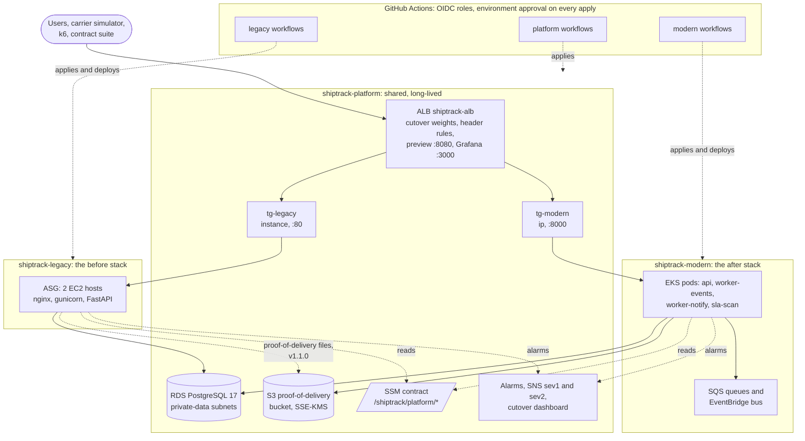

### How the ALB routes a request

Changing `var.cutover` in `shiptrack-platform` is the cutover. Rules are evaluated lowest priority
number first. Both stacks answer with `X-ShipTrack-Stack`, so a test that landed on the wrong stack
fails instead of passing quietly.


### shiptrack-platform

#### Network and data

The private-app subnets are /20 because the VPC CNI gives every pod a VPC address. The database
accepts connections only from the `shiptrack-db-client` security group, which both stacks attach.

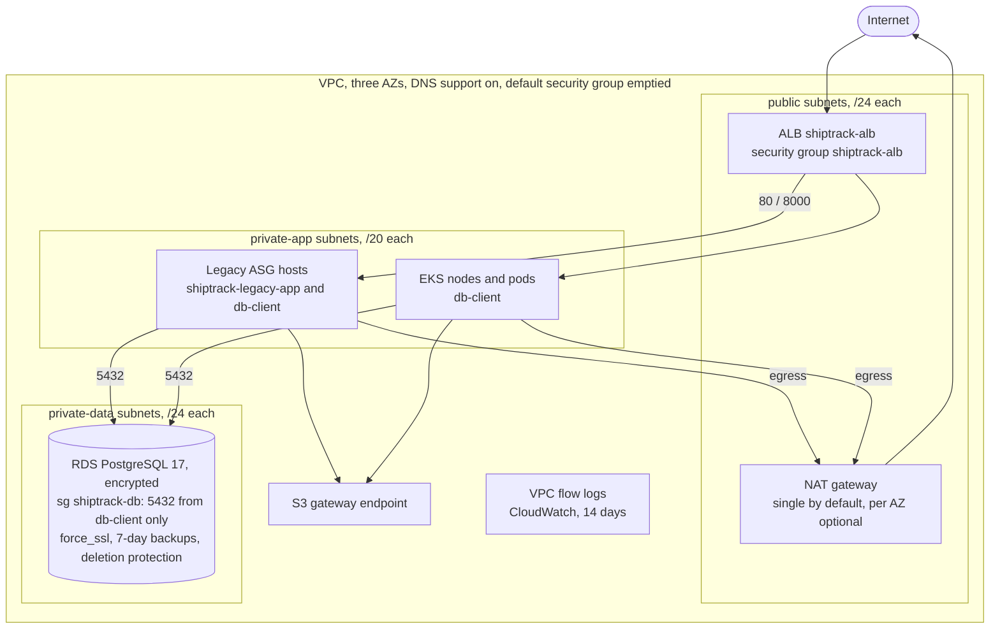

#### Shared services

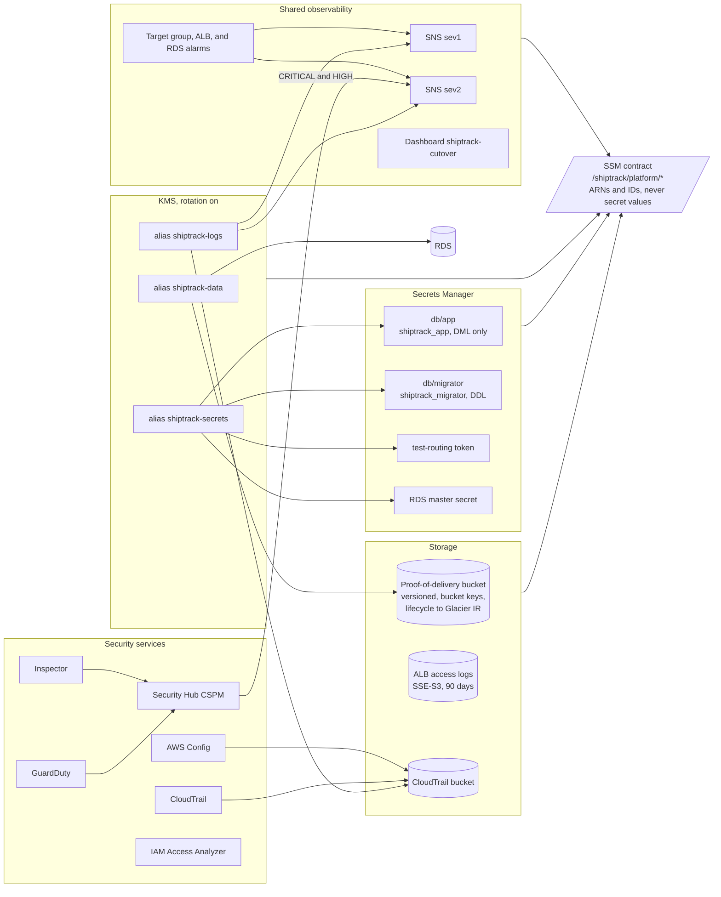

#### Bootstrap and pipeline roles

Nothing is applied from a workstation. The OIDC provider, the seed role, and the GitHub
environments are made by hand once. `apply-bootstrap` then creates the state bucket, the permission
boundary, and the nine roles that every other workflow assumes.

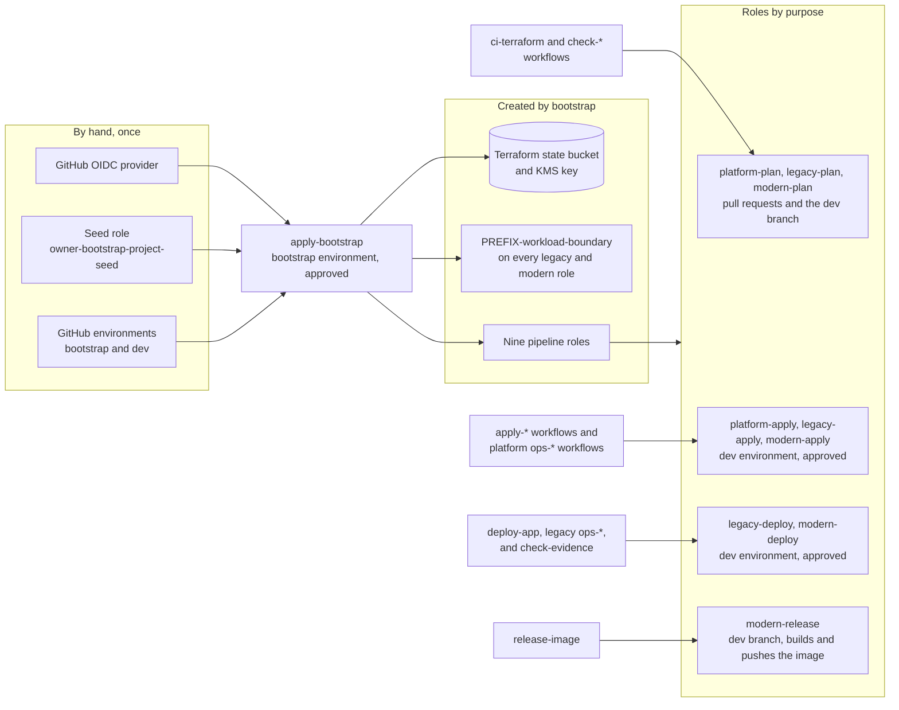

### shiptrack-legacy

The anti-patterns are requirements, tagged in code as `LEGACY AP-xx`. Each one is fixed by the
matching `REM-xx` in `shiptrack-modern`.

#### One host

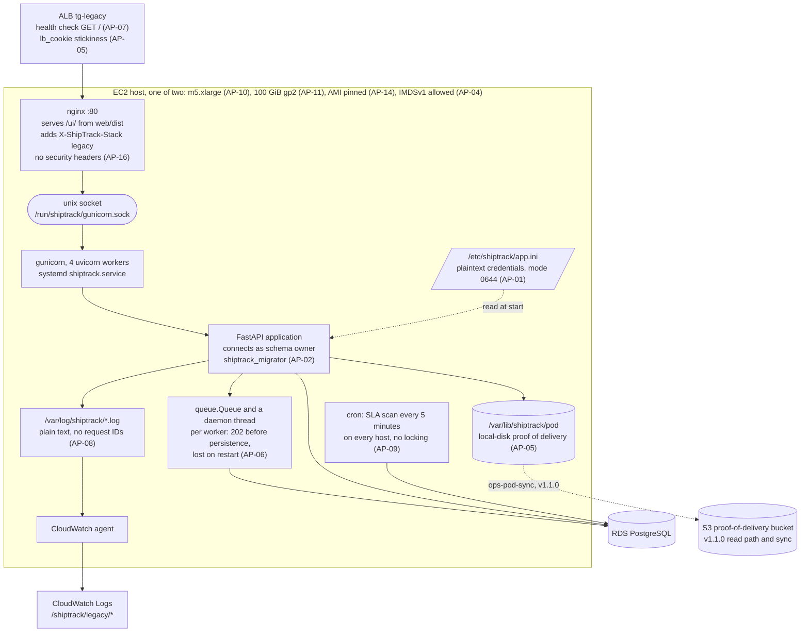

#### Infrastructure around the hosts

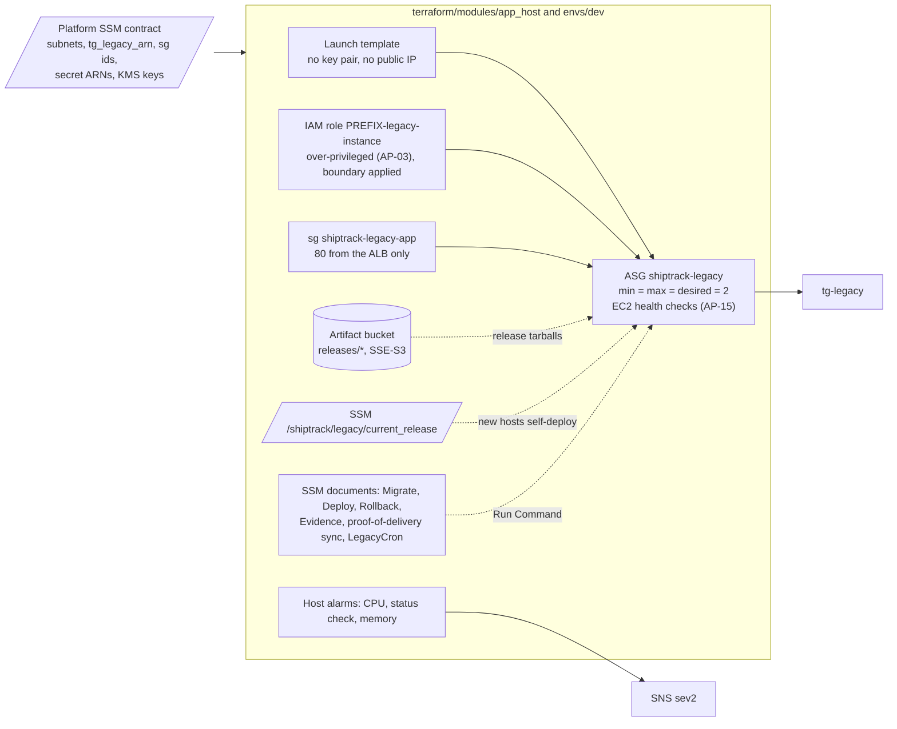

#### Deploying a release

`deploy-app` never runs Terraform and Terraform never writes `current_release`. A deploy
restarts each host in place without leaving the target group (AP-12), and the database is not
rolled back.

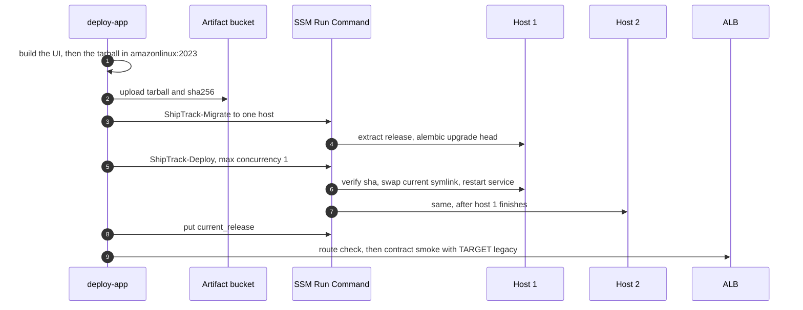

### shiptrack-modern

#### In the cluster

One image runs five roles through `python -m shiptrack <role>`. Each service account has its own
Pod Identity role, named `PREFIX-modern-*` and carrying the platform boundary.

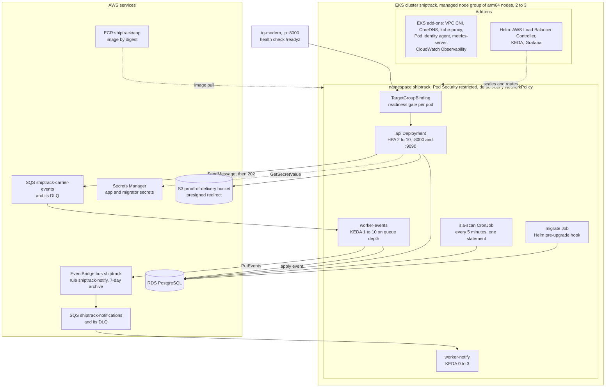

#### Event ingestion, before and after

Legacy answers `202` before the event is stored, so a restart loses what is in the queue (AP-06).
Modern answers `202` once SQS holds the event, and a worker applies it later (REM-06).

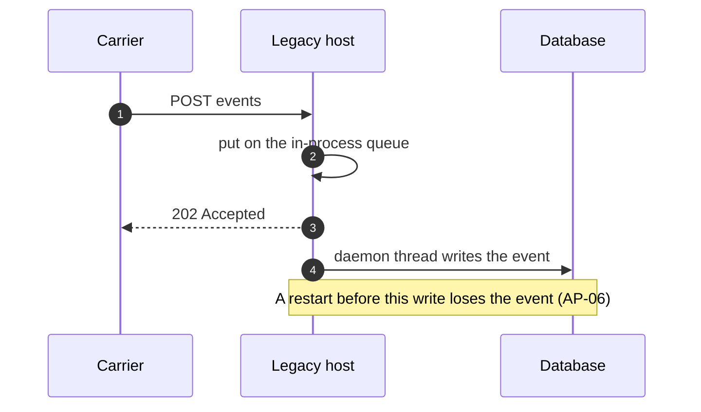

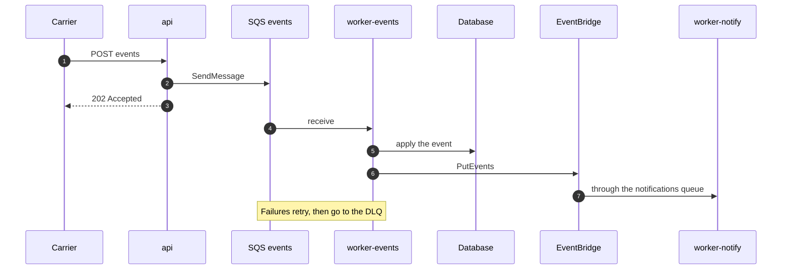

#### Observability

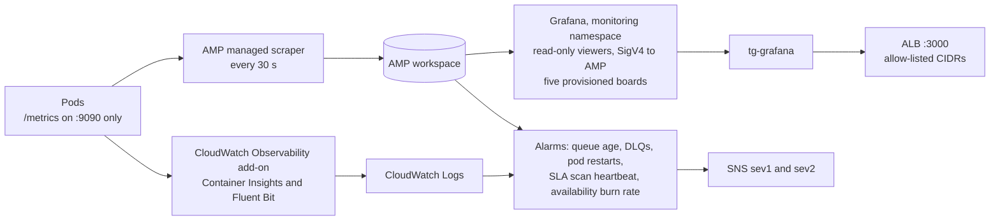

#### Delivery

`release-image` hands the digest to `deploy-app`, which renders Helm values from SSM, upgrades with
`--atomic`, smoke-tests through the ALB with the platform's contract suite, and rolls back if the
smoke fails. Terraform runs as two roots, `cluster` then `addons`, after one approval.

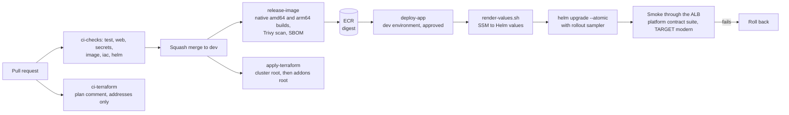

## Layout

| Path | What it holds |
|---|---|
| `bootstrap/` | State bucket, state key, the workload permission boundary, and the nine pipeline roles. Applied only by `apply-bootstrap.yml` |
| `terraform/modules/` | `network`, `kms`, `database`, `storage`, `ingress`, `observability`, `contract`, `security-services` |
| `terraform/envs/dev/` | The environment that wires the modules together |
| `db/` | `bootstrap.sql` (database, roles, schema) and its runbook, and `reset-data.sql` (the data reset, ADR-0034) |
| `validation/contract/` | The API contract suite (pytest and httpx): the executable form of legacy design §3, run against either stack through the ALB |
| `validation/simulator/` | The carrier event simulator: creates shipments, sends lifecycles with duplicates and out-of-order events, and records a ledger |
| `validation/loadtest/` | The k6 scenarios: `baseline`, `stress`, and `soak` |
| `scripts/` | `terraform-ci.sh`, the plan, apply, and drift wrapper that masks identifiers in logs; `force-unlock.sh`; `ssm-run.sh` and `reset-data.sh` for the data reset; and their shell tests |

## Workflows

| Workflow | Runs | Does |
|---|---|---|
| `apply-bootstrap.yml` | by hand, `bootstrap` environment | Creates the state bucket on the first run, then the boundary and roles |
| `ci-terraform.yml` | pull requests | Format, validate, tflint, Checkov, Trivy, and a plan comment with addresses and actions only |
| `apply-terraform.yml` | push to `dev` (including a change to `scripts/reset-data.sh` or `db/reset-data.sql`, which the reset document embeds), or by hand, `dev` environment | Plans and applies `terraform/envs/dev`; a reviewer approves each run |
| `ci-scrub.yml` | pull requests | gitleaks plus rules for account IDs and ALB DNS names |
| `ci-simulator.yml` | pull requests touching the simulator | Lint and tests |
| `ops-unlock-state.yml` | by hand, `dev` environment | Removes a stale state lock, given its ID. Refuses a lock with another ID or one younger than 30 minutes (ADR-0025) |
| `ops-reset-data.yml` | by hand, `dev` environment | Deletes every shipment, its events, documents, and alerts, and the document files in S3 and on each legacy host, then seeds five demo shipments (`MF0000000001` to `MF0000000005`). Needs the typed confirmation `delete-all-shipments`; cannot be undone (ADR-0034) |
| `check-drift.yml` | nightly, and by hand | Plans `terraform/envs/dev` with the plan role. Changes open or update one issue, "Drift detected: platform/dev", with addresses and actions only; a clean plan closes it (ADR-0027) |
| `check-live-stack.yml` | by hand | Runs the contract suite (`smoke`, `full`, or `sla`) or a k6 baseline against one stack through the ALB. Uploads nothing |
| `ci-validation.yml` | pull requests touching `validation/` or `scripts/` | Lint and tests for the contract suite and the simulator, `k6 inspect` for each scenario, and the shell tests |
| `check-cutover-gates.yml` | by hand | Judges gates G2 to G5 over a soak window from CloudWatch with the plan role and prints a table of numbers (ADR-0028) |
| `check-security-findings.yml` | by hand | Inspector findings by severity and fix availability, and Security Hub CRITICAL and HIGH; fails on a fixable CRITICAL or HIGH in modern's resources (ADR-0029). The wave 0 exit criterion |
| `ops-rollback-cutover.yml` | by hand, `dev` environment | Break-glass: all weighted routing back to legacy 100, modern 0, without a pull request. See `docs/runbooks/break-glass-rollback.md` |

### Workflow names

A workflow file is `<category>-<what>.yml`, and its `name:` is the file name without `.yml`, so the
Actions list sorts by what a workflow does.

| Prefix | Does | Runs on | Needs approval |
|---|---|---|---|
| `ci-` | Checks a pull request. Changes nothing in AWS | pull request | No |
| `apply-` | Applies Terraform | push to `dev`, or by hand | `dev` environment (`bootstrap` for `apply-bootstrap`) |
| `release-` | Builds an artifact and pushes it | push to `dev`, or by hand | No |
| `deploy-` | Puts a release on the running stack | after a release, or by hand | `dev` environment |
| `ops-` | One operation on a running system: rollback, unlock, cron, database | by hand | `dev` environment |
| `check-` | Reads state or judges evidence. Changes nothing | by hand, or a schedule | No |

## Opening both UIs side by side

The ALB's address serves legacy: the weighted rules send all traffic to it until the cutover moves
weights. To open the modern UI beside it without the test-routing headers, set the `PREVIEW_CIDRS`
repository **secret** to a JSON list of the addresses that may reach it, for example
`["203.0.113.7/32"]`, and run `apply-terraform`. That adds a listener on port 8080 that forwards
everything to one stack: modern while legacy takes the traffic, and legacy after the cutover
(`preview_stack`, ADR-0032), so legacy's UI stays reachable beside modern's. Then:

- legacy: `http://<ALB address>/ui/`
- modern: `http://<ALB address>:8080/ui/`
- Grafana, on modern's metrics: `http://<ALB address>:3000/` (ADR-0035)

It is a secret, not a variable, because it names a person's address and the logs and pull request
comments of this repository are public: a secret is masked in logs, and the plan prints the rules
by position, not by address. Left unset, nothing is created, and `0.0.0.0/0` is refused. The
listeners are outside the cutover weights (ADR-0026, ADR-0035). The Grafana port opens to the same
addresses and no others. Delete the secret and apply to remove both.

## Status

| Phase | State |
|---|---|
| P0 Bootstrap | Done and applied |
| P6a Terraform workflows | Done and in use |
| P6 scrub and local checks | Done: `ci-scrub.yml`, `.gitleaks.toml`, `.pre-commit-config.yaml`, `.tflint.hcl`, `.checkov.yaml` |
| P1 Network and KMS | Done and applied |
| P2 Database | Done and applied; the database is bootstrapped (see the runbook) |
| P3 Storage and ingress | Done and applied; `track` and `default` are both at modern 100, the preview port shows legacy (ADR-0032), and the Grafana port (3000) opens to the same addresses (ADR-0035) |
| P5 Observability and contract | Done and applied |
| P4 Security services | Done and applied. Config is adopted and recording, and the Inspector enabler and ECR scanning configuration are created (ADR-0022) |
| P6b Drift and validation workflows | Done and in use: `check-drift.yml`, `check-live-stack.yml`, `ci-validation.yml` (ADR-0027) |
| P7 Validation tooling | On `dev`: the simulator, which has seeded the legacy stack, the contract suite, and the k6 scenarios. The contract suite is what modern's `deploy-app.yml` runs as its smoke test |
| P8 Runbooks | `docs/runbooks/cutover.md` and `docs/runbooks/break-glass-rollback.md` are written and were used for the cutover, which is complete. The runbooks are still to be iterated |

## Local checks

These need no AWS credentials.

```sh
terraform fmt -check -recursive
terraform -chdir=terraform/envs/dev init -backend=false && terraform -chdir=terraform/envs/dev validate
for m in terraform/modules/*/; do terraform -chdir="$m" init -backend=false && terraform -chdir="$m" test; done   # offline plan tests
tflint --recursive
checkov --config-file .checkov.yaml -d terraform   # one -d per run: repeated -d scans only the first
actionlint
```

`bootstrap/tests/moto.sh` runs the real bootstrap script against a moto server. `db/tests/bootstrap.sh`
runs `bootstrap.sql` twice against a throwaway PostgreSQL 17 container (it needs Docker) and checks
that the second run changes nothing; `db/tests/reset-data.sh` runs `reset-data.sql` as the
application role against the same kind of container.

The wrapper scripts and the validation tooling are checked without AWS too:

```sh
scripts/tests/test_terraform_ci.sh && scripts/tests/test_force_unlock.sh   # against fake aws and terraform
shellcheck scripts/*.sh scripts/tests/*.sh
( cd validation/contract && uv sync --frozen && uv run --frozen pytest --collect-only -q \
    && uv run --frozen pytest tests/test_endpoint_coverage.py -q )         # needs no BASE_URL
( cd validation/simulator && uv sync --frozen && uv run --frozen ruff check . && uv run --frozen pytest -q )
```

## Running the validation suites

`check-live-stack.yml` is dispatched by hand, from `dev`, with the plan role. It reads the base URL and the
test-routing token itself and uploads nothing, because a failure message can contain the ALB address.

| Suite | Marker or script | Notes |
|---|---|---|
| `contract-smoke` | `-m smoke` | The 8-test subset that modern's `deploy-app.yml` runs after every deploy |
| `contract-full` | `-m "not sla"` | Everything that needs one stack |
| `k6-baseline` | `loadtest/baseline.js` | 20 rps for 30 minutes against one stack; the summary stays on the runner |

`target` is `legacy`, `modern`, or `none`. The proof-of-delivery tests need a stack pinned with `legacy` or
`modern`, because an upload and its read-back must reach the same stack. The suites change nothing
about routing: they address a stack with the test-routing headers, so the weights can stay as they are.
