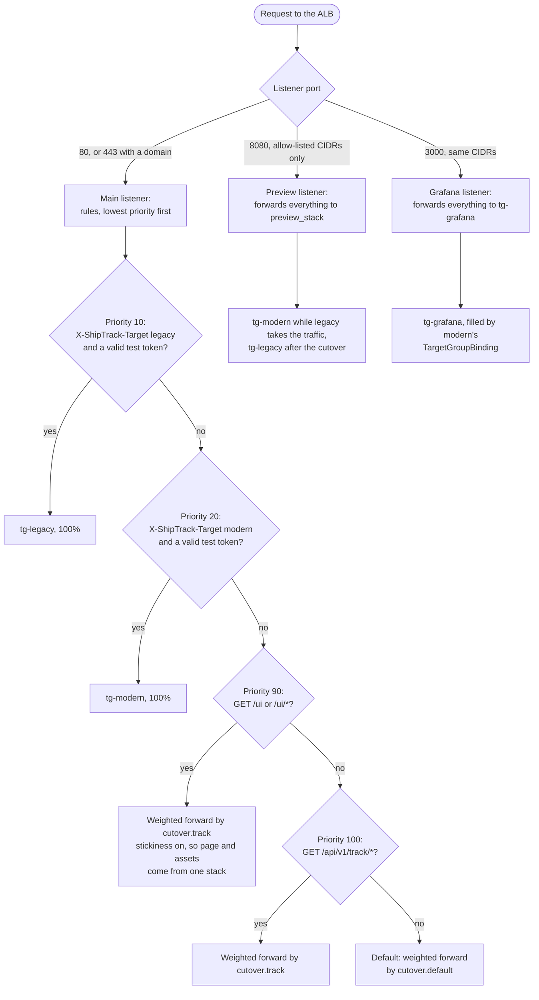

# shiptrack-platform

The shared AWS foundation of the ShipTrack cloud migration, and its control point. It owns what both
stacks share (network, database, load balancer, storage, security services), the ALB weights that move
traffic from the source stack to the target stack, and the validation tooling that defines "correct"
for both.

- Design: [`docs/DESIGN.md`](docs/DESIGN.md)
- Decisions: [`docs/ADR.md`](docs/ADR.md)
- Detailed diagrams: [`docs/ARCHITECTURE.md`](docs/ARCHITECTURE.md)
- First-time setup, including the manual OIDC provider and seed role: [`bootstrap/README.md`](bootstrap/README.md)
- Database bootstrap: [`db/RUNBOOK-db-bootstrap.md`](db/RUNBOOK-db-bootstrap.md)

**Two rules.** Nothing is applied from a workstation: every AWS change is a GitHub Actions workflow that
assumes an OIDC role, with a reviewer approving each apply. And this repository is public, so no account
ID, ALB address, host ID, or secret value is ever committed; `ci-scrub.yml` fails a pull request that adds one.

## The migration

| Repository | Role in the migration |
|---|---|
| [`shiptrack-platform`](https://github.com/loriamichaelj/shiptrack-platform) | This repository: shared infrastructure, cutover control, validation |
| [`shiptrack-legacy`](https://github.com/loriamichaelj/shiptrack-legacy) | The source stack: a FastAPI app on EC2 behind the ALB, with deliberate anti-patterns to assess |
| [`shiptrack-modern`](https://github.com/loriamichaelj/shiptrack-modern) | The target stack: the same API replatformed onto EKS and refactored where a lift could not fix a defect |
| [`shiptrack-modern-azure`](https://github.com/loriamichaelj/shiptrack-modern-azure), [`shiptrack-modern-gcp`](https://github.com/loriamichaelj/shiptrack-modern-gcp) | The same image taken to AKS and GKE |

The strategy follows the 7 Rs that AWS Prescriptive Guidance defines
([About the migration strategies](https://docs.aws.amazon.com/prescriptive-guidance/latest/large-migration-guide/migration-strategies.html)):
**replatform** the runtime, **refactor** the three architectural defects, **retain** the shared database
and the source stack as a fallback, and **retire** the source stack's scheduled jobs. Rehost, relocate,
and repurchase are not used. The full mapping is in the `shiptrack-legacy` and `shiptrack-modern` READMEs.

**Cutover.** Traffic moves in waves, by pull request to the weights here: Wave 0 dark launch, Wave 1 the
read path and the UI, Wave 2 the write path, then Wave 3 the scheduled jobs. Both stacks answer with an
`X-ShipTrack-Stack` header, so a test that landed on the wrong stack fails. Rolling back is changing the
weights back. Both stacks read what this repository publishes through the SSM contract under
`/shiptrack/platform/` and never its Terraform state.

## Architecture

### The three repositories together

One ALB and one database serve both stacks. `shiptrack-platform` owns everything shared and the
cutover weights, `shiptrack-legacy` and `shiptrack-modern` each read the platform's published values
through SSM and never its Terraform state, and every AWS change comes from a GitHub Actions workflow.


### How the ALB routes a request

Changing `var.cutover` in `shiptrack-platform` is the cutover. Rules are evaluated lowest priority
number first. Both stacks answer with `X-ShipTrack-Stack`, so a test that landed on the wrong stack
fails instead of passing quietly.



### Network and data

The private-app subnets are /20 because the VPC CNI gives every pod a VPC address. The database
accepts connections only from the `shiptrack-db-client` security group, which both stacks attach.


More diagrams (shared services, pipeline roles, one legacy host, the cluster, the UI, event ingestion,
observability, delivery) are in [`docs/ARCHITECTURE.md`](docs/ARCHITECTURE.md).

## Layout

| Path | What it holds |
|---|---|
| `bootstrap/` | State bucket, permission boundary, and the nine pipeline roles. Applied only by `apply-bootstrap.yml` |
| `terraform/modules/` | `network`, `kms`, `database`, `storage`, `ingress`, `observability`, `contract`, `security-services` |
| `terraform/envs/dev/` | The environment that wires the modules together |
| `db/` | `bootstrap.sql` (database, roles, schema) with its runbook, and `reset-data.sql` |
| `validation/` | The API contract suite (pytest), the carrier event simulator, and the k6 load scenarios |
| `scripts/` | The plan, apply, and drift wrapper that masks identifiers in logs, and helpers for unlocking state and resetting data |

## Workflows

| Workflow | Does |
|---|---|
| `apply-bootstrap.yml` | Creates the state bucket, the boundary, and the roles (by hand, `bootstrap` environment) |
| `ci-terraform.yml` | On pull requests: format, validate, tflint, Checkov, Trivy, and a plan comment with addresses and actions only |
| `apply-terraform.yml` | Plans and applies `terraform/envs/dev`; a reviewer approves each run |
| `ci-scrub.yml`, `ci-simulator.yml`, `ci-validation.yml` | On pull requests: secret and identifier scan; simulator and validation tooling checks |
| `check-drift.yml` | Nightly plan; opens or updates one issue when the live stack drifts, and closes it when clean |
| `check-live-stack.yml` | Runs the contract suite or a k6 baseline against one stack through the ALB |
| `check-cutover-gates.yml` | Judges the cutover gates over a soak window from CloudWatch |
| `check-security-findings.yml` | Inspector and Security Hub findings; fails on a fixable CRITICAL or HIGH in modern's resources |
| `ops-rollback-cutover.yml` | Break-glass: all weighted routing back to legacy without a pull request |
| `ops-reset-data.yml` | Deletes every shipment and document and seeds five demo shipments. Needs a typed confirmation and cannot be undone |
| `ops-unlock-state.yml` | Removes a stale state lock, given its ID |

A workflow file is `<category>-<what>.yml`, and its `name:` is the file name without `.yml`. `ci-` checks
a pull request, `apply-` applies Terraform, `release-` builds an artifact, `deploy-` puts a release on the
running stack, `ops-` is one operation on a running system, and `check-` reads state and changes nothing.
`apply-`, `deploy-`, and `ops-` need the `dev` environment's approval.

## Opening both UIs side by side

Modern serves the main address and legacy stays running as a fallback on a preview port. To open both,
set the `PREVIEW_CIDRS` repository **secret** to a JSON list of the addresses that may reach it, for
example `["203.0.113.7/32"]`, and run `apply-terraform`. It adds a listener on port 8080 that forwards
everything to one stack, and opens the Grafana port to the same addresses.

- modern: `http://<ALB address>/ui/`
- legacy: `http://<ALB address>:8080/ui/`
- Grafana, on modern's metrics: `http://<ALB address>:3000/`

It is a secret, not a variable, because it names a person's address and this repository's logs are public.
Left unset, nothing is created, and `0.0.0.0/0` is refused. Delete the secret and apply to remove both.

## Status

| Area | State |
|---|---|
| Bootstrap, network, KMS, database, storage, ingress, observability, security services | Done and applied |
| Terraform, drift, scrub, and validation workflows | Done and in use |
| Validation tooling | The simulator, the contract suite, and the k6 scenarios. The contract suite is also modern's smoke test |
| Cutover | Complete: `track` and `default` are at modern 100, and the preview port shows legacy |
| Runbooks | `docs/runbooks/cutover.md` and `docs/runbooks/break-glass-rollback.md` are written and were used; they are still to be iterated |

## Local checks

These need no AWS credentials.

```sh
terraform fmt -check -recursive
terraform -chdir=terraform/envs/dev init -backend=false && terraform -chdir=terraform/envs/dev validate
for m in terraform/modules/*/; do terraform -chdir="$m" init -backend=false && terraform -chdir="$m" test; done
tflint --recursive
checkov --config-file .checkov.yaml -d terraform   # one -d per run: repeated -d scans only the first
actionlint
```

The bootstrap script, the SQL, and the wrapper scripts are tested against moto, throwaway PostgreSQL 17
containers (they need Docker), and fake `aws` and `terraform`: see `bootstrap/tests/`, `db/tests/`, and
`scripts/tests/`. The validation tooling checks with `uv run pytest` in `validation/contract` and
`validation/simulator`.

## Running the validation suites

`check-live-stack.yml` is dispatched by hand from `dev` with the plan role. It reads the base URL and the
test-routing token itself and uploads nothing, because a failure message can contain the ALB address.

| Suite | What it runs |
|---|---|
| `contract-smoke` | The 8-test subset that modern's `deploy-app.yml` runs after every deploy |
| `contract-full` | Everything that needs one stack |
| `k6-baseline` | 20 requests a second for 30 minutes against one stack; the summary stays on the runner |

`target` is `legacy`, `modern`, or `none`. The proof-of-delivery tests need a stack pinned with `legacy` or
`modern`, because an upload and its read-back must reach the same stack. The suites change nothing about
routing: they address a stack with the test-routing headers.
