# Architecture

The detailed diagrams of the three repositories. The three main diagrams (the three repositories together, how the ALB routes a request, and the network and data) are in the [README](../README.md). All diagrams use placeholders, never account IDs, addresses, or secret values.

## shiptrack-platform

### Shared services

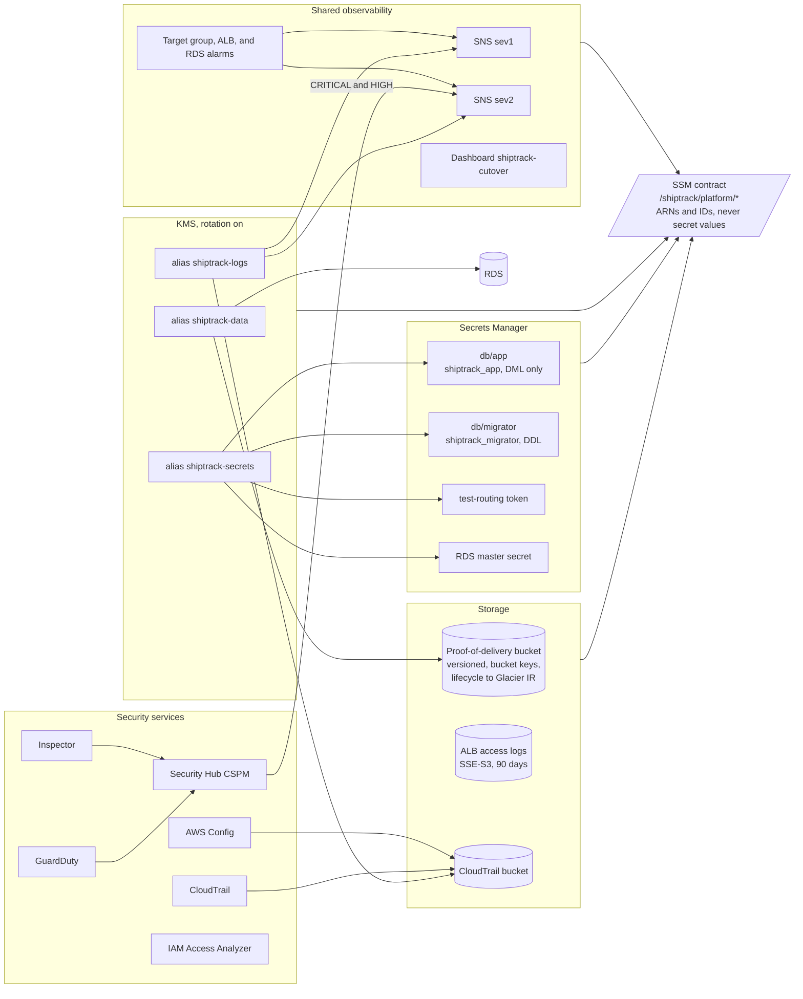

### Bootstrap and pipeline roles

Nothing is applied from a workstation. The OIDC provider, the seed role, and the GitHub
environments are made by hand once. `apply-bootstrap` then creates the state bucket, the permission
boundary, and the nine roles that every other workflow assumes.

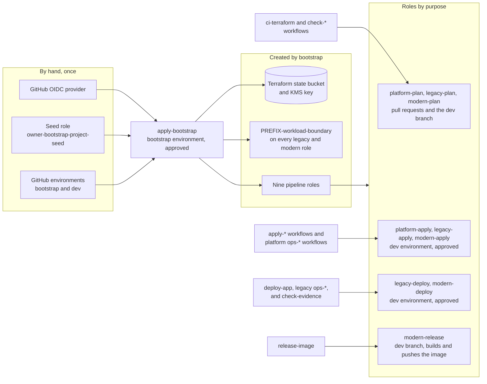

## shiptrack-legacy

The anti-patterns are requirements, tagged in code as `LEGACY AP-xx`. Each one is fixed by the
matching `REM-xx` in `shiptrack-modern`.

### One host

```mermaid
flowchart TB
    alb["ALB tg-legacy<br/>health check GET / (AP-07)<br/>lb_cookie stickiness (AP-05)"]

    subgraph host["EC2 host, one of two: m5.xlarge (AP-10), 100 GiB gp2 (AP-11), AMI pinned (AP-14), IMDSv1 allowed (AP-04)"]
        nginx["nginx :80<br/>serves /ui/ from web/dist<br/>adds X-ShipTrack-Stack legacy<br/>no security headers (AP-16)"]
        sock(["unix socket<br/>/run/shiptrack/gunicorn.sock"])
        gun["gunicorn, 4 uvicorn workers<br/>systemd shiptrack.service"]
        app["FastAPI application<br/>connects as schema owner<br/>shiptrack_migrator (AP-02)"]
        q["queue.Queue and a daemon thread<br/>per worker: 202 before persistence,<br/>lost on restart (AP-06)"]
        disk[("/var/lib/shiptrack/pod<br/>local-disk proof of delivery (AP-05)")]
        ini[/"/etc/shiptrack/app.ini<br/>plaintext credentials, mode 0644 (AP-01)"/]
        cron["cron: SLA scan every 5 minutes<br/>on every host, no locking (AP-09)"]
        logs["/var/log/shiptrack/*.log<br/>plain text, no request IDs (AP-08)"]
        cwa["CloudWatch agent"]
    end

    rds[("RDS PostgreSQL")]
    s3[("S3 proof-of-delivery bucket<br/>v1.1.0 read path and sync")]
    cwl["CloudWatch Logs<br/>/shiptrack/legacy/*"]

    alb --> nginx --> sock --> gun --> app
    app --> q
    q --> rds
    app --> rds
    app --> disk
    ini -. "read at start" .-> app
    cron --> rds
    app --> logs
    logs --> cwa --> cwl
    disk -. "ops-pod-sync, v1.1.0" .-> s3
```

### Infrastructure around the hosts

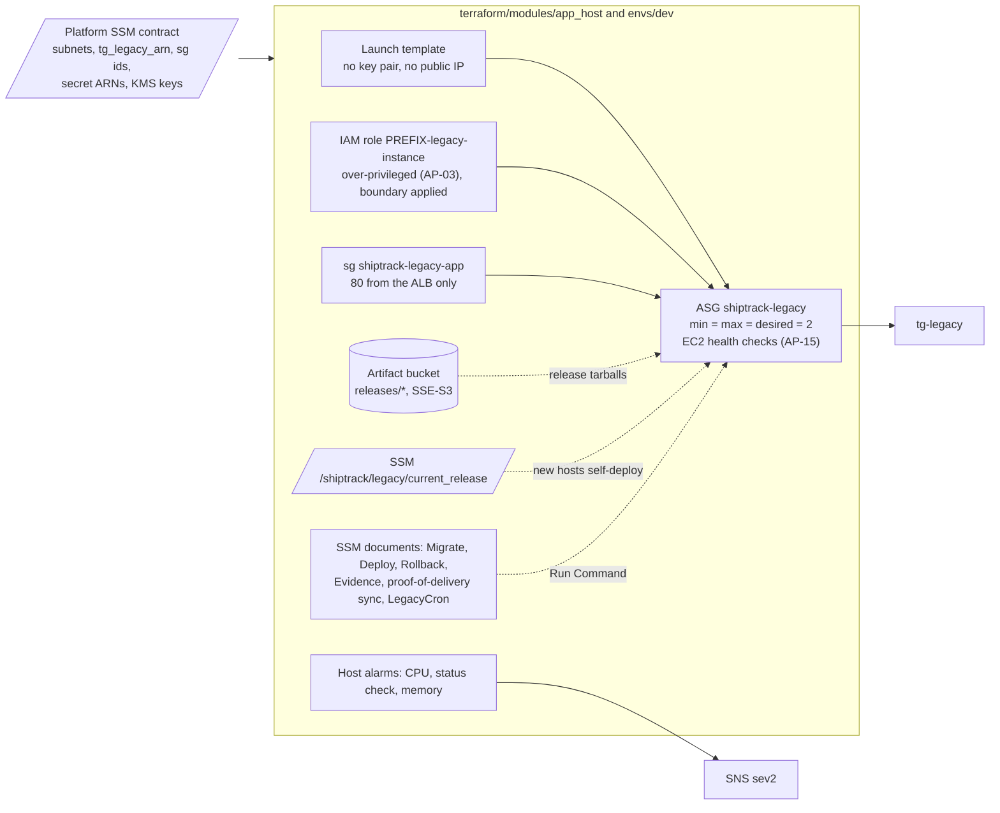

### Deploying a release

`deploy-app` never runs Terraform and Terraform never writes `current_release`. A deploy
restarts each host in place without leaving the target group (AP-12), and the database is not
rolled back.

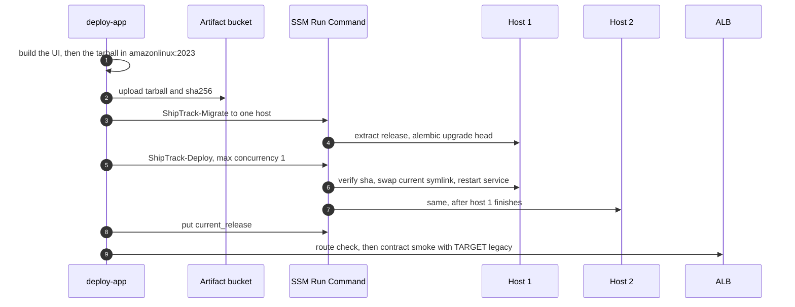

## shiptrack-modern

### In the cluster

One image runs five roles through `python -m shiptrack <role>`. Each service account has its own
Pod Identity role, named `PREFIX-modern-*` and carrying the platform boundary.

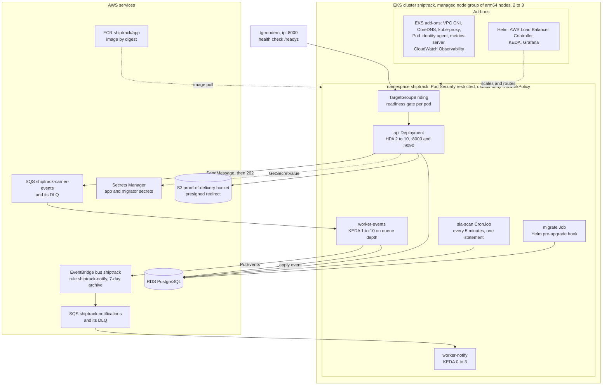

### The UI in the browser

The UI is a single-page app that the `api` pods serve under `/ui/`. It calls only the public API, and
one runtime above the router is shared by every page. Legacy's UI is a separate, minimal tracking page
served by nginx and is not changed.

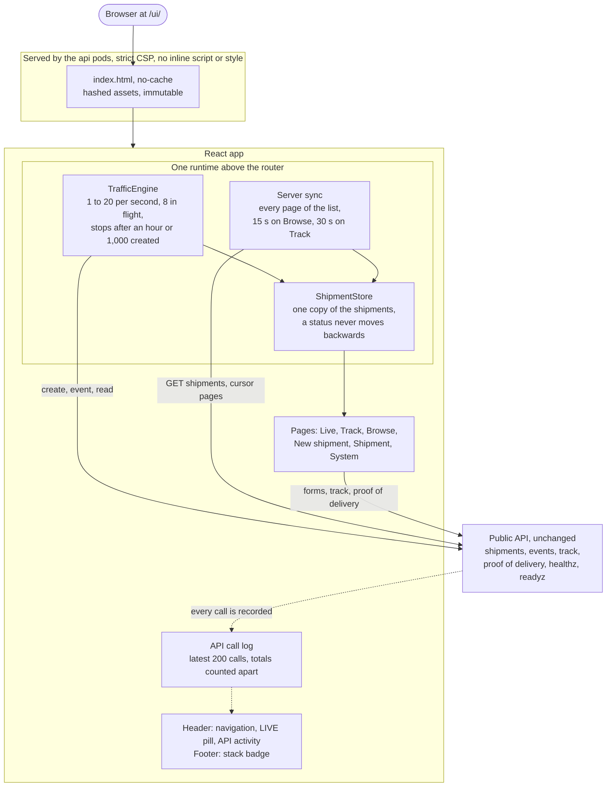

### Event ingestion in the source and target stacks

Legacy answers `202` before the event is stored, so a restart loses what is in the queue (AP-06).
Modern answers `202` once SQS holds the event, and a worker applies it later (REM-06).

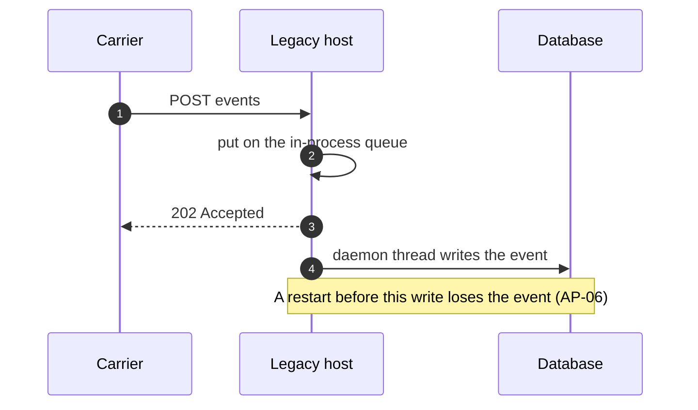

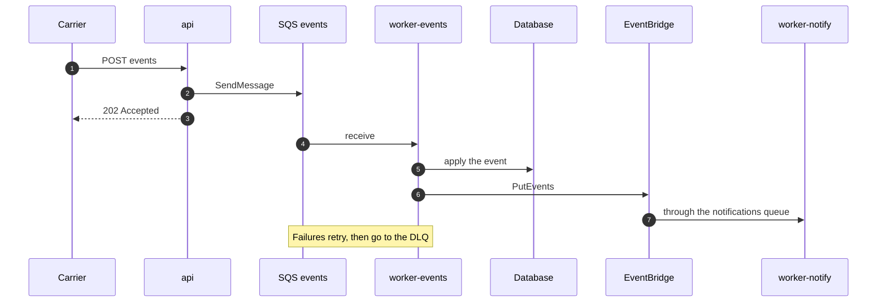

### Observability

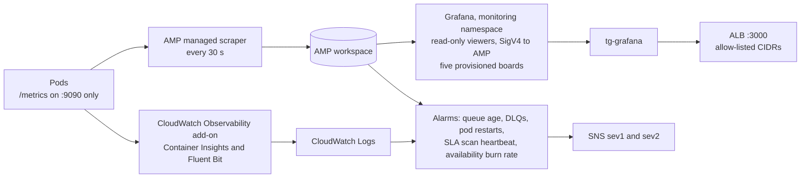

### Delivery

`release-image` hands the digest to `deploy-app`, which renders Helm values from SSM, upgrades with
`--atomic`, smoke-tests through the ALB with the platform's contract suite, and rolls back if the
smoke fails. Terraform runs as two roots, `cluster` then `addons`, after one approval.

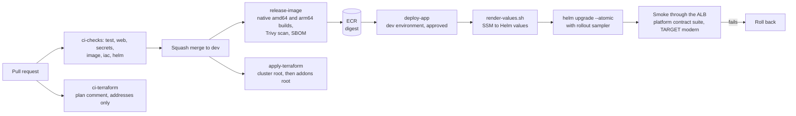
